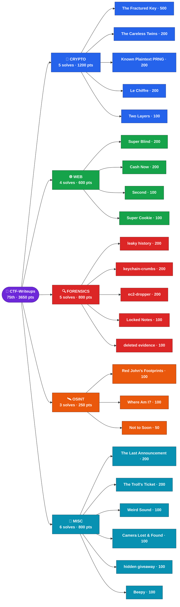

# 🧬 p53ud0p4n1c: CTF Writeups

> **<CTF NAME>** · November 14, 2026
> 🏁 **75th place** · ⭐ **3650 points** · 23 challenges solved

---

## 👥 Team

| Member | Role | Score |
|---|---|:---:|
| aelitorse | 👑 Captain | 900 |
| holocynth | Member | 900 |
| skychaser | Member | 700 |
| z3r0grav1ty | Member | 1150 |

---

## 🗺️ Challenge Map



---

## 🌲 Repo Structure

```
CTF-Writeups/
│
├── README.md
│
├── CRYPTO/
│   ├── The-Fractured-Key.md
│   ├── The-Careless-Twins.md
│   ├── Known-Plaintext-PRNG.md
│   ├── Le-Chiffre.md
│   └── Two-Layers.md
│
├── WEB/
│   ├── Super-Blind.md
│   ├── Cash-Now.md
│   ├── Second.md
│   └── Super-Cookie.md
│
├── FORENSICS/
│   ├── leaky-history.md
│   ├── keychain-crumbs.md
│   ├── ec2-dropper.md
│   ├── Locked-Notes.md
│   └── deleted-evidence.md
│
├── OSINT/
│   ├── Red-Johns-Footprints.md
│   ├── Where-Am-I.md
│   └── Not-to-Soon.md
│
└── MISC/
    ├── The-Last-Announcement.md
    ├── The-Trolls-Ticket.md
    ├── Weird-Sound.md
    ├── Camera-Lost-and-Found.md
    ├── hidden-giveaway.md
    └── Beepy.md
```

---

## 📊 Category Breakdown

| Category | Solves | Points |
|---|:---:|:---:|
| 🔐 CRYPTO | 5 | 1200 |
| 🔍 FORENSICS | 5 | 800 |
| 🎲 MISC | 6 | 800 |
| 🌐 WEB | 4 | 600 |
| 🛰️ OSINT | 3 | 250 |
| **Total** | **23** | **3650** |

---

## ✅ All Writeups

### 🔐 CRYPTO
| Challenge | Points |
|---|:---:|
| [The Fractured Key](CRYPTO/The-Fractured-Key.md) | 500 |
| [The Careless Twins](CRYPTO/The-Careless-Twins.md) | 200 |
| [Known Plaintext PRNG](CRYPTO/Known-Plaintext-PRNG.md) | 200 |
| [Le Chiffre](CRYPTO/Le-Chiffre.md) | 200 |
| [Two Layers](CRYPTO/Two-Layers.md) | 100 |

### 🌐 WEB
| Challenge | Points |
|---|:---:|
| [Super Blind](WEB/Super-Blind.md) | 200 |
| [Cash Now](WEB/Cash-Now.md) | 200 |
| [Second](WEB/Second.md) | 100 |
| [Super Cookie](WEB/Super-Cookie.md) | 100 |

### 🔍 FORENSICS
| Challenge | Points |
|---|:---:|
| [leaky history](FORENSICS/leaky-history.md) | 200 |
| [keychain-crumbs](FORENSICS/keychain-crumbs.md) | 200 |
| [ec2-dropper](FORENSICS/ec2-dropper.md) | 200 |
| [Locked Notes](FORENSICS/Locked-Notes.md) | 100 |
| [deleted evidence](FORENSICS/deleted-evidence.md) | 100 |

### 🛰️ OSINT
| Challenge | Points |
|---|:---:|
| [Red John's Footprints](OSINT/Red-Johns-Footprints.md) | 100 |
| [Where Am I?](OSINT/Where-Am-I.md) | 100 |
| [Not to Soon](OSINT/Not-to-Soon.md) | 50 |

### 🎲 MISC
| Challenge | Points |
|---|:---:|
| [The Last Announcement](MISC/The-Last-Announcement.md) | 200 |
| [The Troll's Ticket](MISC/The-Trolls-Ticket.md) | 200 |
| [Weird Sound](MISC/Weird-Sound.md) | 100 |
| [Camera Lost & Found](MISC/Camera-Lost-and-Found.md) | 100 |
| [hidden giveaway](MISC/hidden-giveaway.md) | 100 |
| [Beepy](MISC/Beepy.md) | 100 |

---

## 🕒 Solve Timeline (Nov 14, 2026)

```mermaid
timeline
    title Solve order
    6:01 PM : Two Layers
    6:02 PM : Le Chiffre
    6:03 PM : deleted evidence
    6:04 PM : Locked Notes : Known Plaintext PRNG
    6:05 PM : ec2-dropper
    6:07 PM : keychain-crumbs
    6:09 PM : Where Am I? : Beepy
    6:14 PM : Super Cookie
    6:18 PM : Cash Now
    6:24 PM : hidden giveaway : Red John's Footprints
    6:59 PM : The Careless Twins
    7:42 PM : The Troll's Ticket
    8:14 PM : Camera Lost & Found
    8:20 PM : Second
    9:00 PM : leaky history
    9:06 PM : The Last Announcement
    9:19 PM : Not to Soon
    10:06 PM : The Fractured Key
    10:07 PM : Super Blind
    11:39 PM : Weird Sound
```

---

Made with 💜 by **p53ud0p4n1c**
