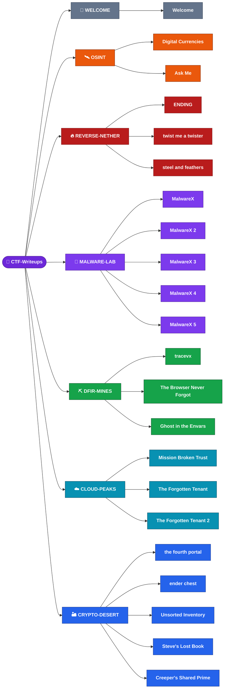

content
# 🧬 p53ud0p4n1c: CTF Writeups

> **<CTF NAME>** · <DATE>
> 🏁 **75th place** · ⭐ **3650 points**

---

## 👥 Team

| Member | Role |
|---|---|
| aelitorse | Captain |
| holocynth | Member |
| skychaser | Member |
| z3r0grav1ty | Member |

---

## 🗺️ Challenge Map



---

## 🌲 Tree View

```
CTF-Writeups/
│
├── README.md
│
├── OSINT/
│   ├── Digital-Currencies.md
│   └── Ask-Me.md
│
├── REVERSE-NETHER/
│   ├── ENDING.md
│   ├── twist-me-a-twister.md
│   └── steel-and-feathers.md
│
├── MALWARE-LAB/
│   ├── MalwareX.md
│   ├── MalwareX-2.md
│   ├── MalwareX-3.md
│   ├── MalwareX-4.md
│   └── MalwareX-5.md
│
├── DFIR-MINES/
│   ├── tracevx.md
│   ├── The-Browser-Never-Forgot.md
│   └── Ghost-in-the-Envars.md
│
├── CLOUD-PEAKS/
│   ├── Mission-Broken-Trust.md
│   ├── The-Forgotten-Tenant.md
│   └── The-Forgotten-Tenant-2.md
│
├── CRYPTO-DESERT/
│   ├── the-fourth-portal.md
│   ├── ender-chest.md
│   ├── Unsorted-Inventory.md
│   ├── Steves-Lost-Book.md
│   └── Creepers-Shared-Prime.md
│
└── WELCOME/
    └── Welcome.md
```

---

## 📊 Categories

| Category | Challenges |
|---|:---:|
| 🛰️ OSINT | 2 |
| 🔥 REVERSE-NETHER | 3 |
| 🦠 MALWARE-LAB | 5 |
| ⛏️ DFIR-MINES | 3 |
| ☁️ CLOUD-PEAKS | 3 |
| 🏜️ CRYPTO-DESERT | 5 |
| 👋 WELCOME | 1 |
| **Total** | **22** |

---

## ✅ All Writeups

### 👋 WELCOME
- [Welcome](WELCOME/Welcome.md)

### 🛰️ OSINT
- [Digital Currencies](OSINT/Digital-Currencies.md)
- [Ask Me](OSINT/Ask-Me.md)

### 🔥 REVERSE-NETHER
- [ENDING](REVERSE-NETHER/ENDING.md)
- [twist me a twister](REVERSE-NETHER/twist-me-a-twister.md)
- [steel and feathers](REVERSE-NETHER/steel-and-feathers.md)

### 🦠 MALWARE-LAB
- [MalwareX](MALWARE-LAB/MalwareX.md)
- [MalwareX 2](MALWARE-LAB/MalwareX-2.md)
- [MalwareX 3](MALWARE-LAB/MalwareX-3.md)
- [MalwareX 4](MALWARE-LAB/MalwareX-4.md)
- [MalwareX 5](MALWARE-LAB/MalwareX-5.md)

### ⛏️ DFIR-MINES
- [tracevx](DFIR-MINES/tracevx.md)
- [The Browser Never Forgot](DFIR-MINES/The-Browser-Never-Forgot.md)
- [Ghost in the Envars](DFIR-MINES/Ghost-in-the-Envars.md)

### ☁️ CLOUD-PEAKS
- [Mission Broken Trust](CLOUD-PEAKS/Mission-Broken-Trust.md)
- [The Forgotten Tenant](CLOUD-PEAKS/The-Forgotten-Tenant.md)
- [The Forgotten Tenant 2](CLOUD-PEAKS/The-Forgotten-Tenant-2.md)

### 🏜️ CRYPTO-DESERT
- [the fourth portal](CRYPTO-DESERT/the-fourth-portal.md)
- [ender chest](CRYPTO-DESERT/ender-chest.md)
- [Unsorted Inventory](CRYPTO-DESERT/Unsorted-Inventory.md)
- [Steve's Lost Book](CRYPTO-DESERT/Steves-Lost-Book.md)
- [Creeper's Shared Prime](CRYPTO-DESERT/Creepers-Shared-Prime.md)
